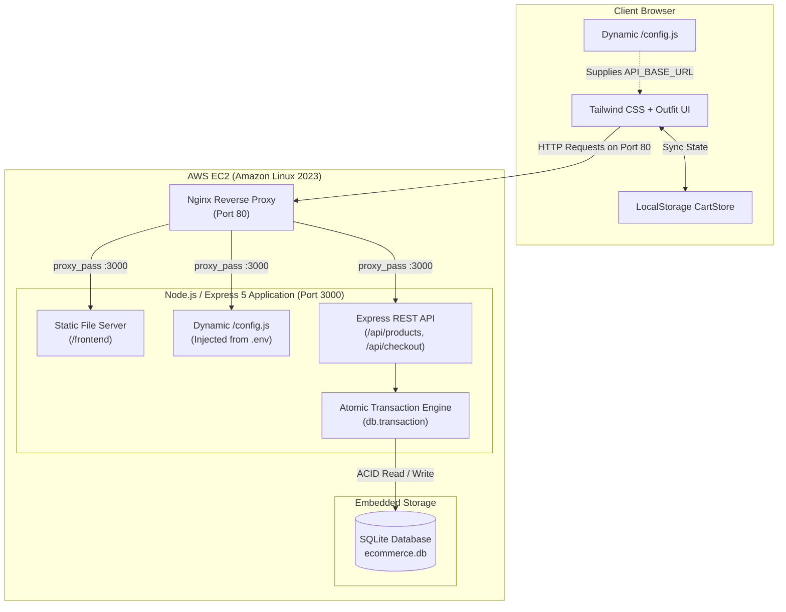

# λ Lambda — Precision Hardware E-Commerce Platform

[](https://nodejs.org/)
[](https://expressjs.com/)
[](https://github.com/WiseLibs/better-sqlite3)
[](https://tailwindcss.com/)
[](https://aws.amazon.com/ec2/)
[](https://nginx.org/)
[](https://opensource.org/licenses/ISC)

> **"Tools built for people who notice."**  
> Lambda is a modern, high-performance e-commerce platform for curated developer hardware and precision peripherals. Built with a minimalist, luxury industrial aesthetic, an atomic SQLite inventory backend, dynamic runtime configuration, and an enterprise-grade AWS EC2 deployment pipeline.

---

## 📑 Table of Contents

- [Overview & Aesthetic Thesis](#-overview--aesthetic-thesis)
- [Key Features](#-key-features)
- [System Architecture](#-system-architecture)
- [Repository Structure](#-repository-structure)
- [Technology Stack](#-technology-stack)
- [API Reference](#-api-reference)
- [Database Schema & Seed Data](#-database-schema--seed-data)
- [Local Development Setup](#-local-development-setup)
- [AWS Cloud Deployment Guide](#-aws-cloud-deployment-guide)
- [Reliability & Security Measures](#-reliability--security-measures)
- [License](#-license)

---

## 🌟 Overview & Aesthetic Thesis

Lambda was crafted under a strict **High-Agency Frontend Design Mandate** to avoid generic, "vibecoded" templates and sterile AI defaults:

- **Intentional Aesthetic Direction:** Luxury industrial minimalism utilizing deep Charcoal and Zinc-950 surfaces (`#09090b`), amber accent highlights (`#fbbf24`), and high-contrast typography powered by Google Font **Outfit**.
- **Asymmetric Editorial Layout:** A 50/50 split-screen hero section pairing curated editorial copy with a sticky 2×2 product mosaic, followed by alternating asymmetric product masonry cards (1 featured item + 2 stacked cards).
- **Tactile Micro-Interactions:** Custom subtle card hover lifts, shimmer skeleton loading animations, smooth slide-in cart drawer transitions, and button pulse feedback.
- **Resilient Dual-Mode Client:** The frontend dynamically queries the live backend API but includes automatic fallback mock data with simulated latency so interfaces never crash during independent client-side testing.

---

## 🚀 Key Features

### 🖥️ Frontend Client (`/frontend`)
- **Responsive Dynamic Catalog:** Renders products fetched from the Express API with real-time stock indicators (`"Only X left"` badge for scarce stock, disabled button for out-of-stock).
- **Shimmer Skeleton States:** Displays animated skeleton loaders while products are fetched asynchronously.
- **Slide-Out Cart Drawer:** Off-canvas modal accessible from any scroll position, supporting quantity increment/decrement, item deletion, live subtotal calculations, and badge counters.
- **Persistent State (`localStorage`):** Retains cart contents (`lambda_cart`) seamlessly across page reloads and browser sessions.
- **2-Column Checkout Modal:** Full-screen modal with order summary review, customer shipping input validation, simulated payment processing, and animated confirmation dialogs.
- **Dynamic Config Injection:** Loads runtime environment endpoints via `<script src="config.js">` served directly by the Express server without requiring rebuilds.

### ⚙️ Backend API (`index.js`)
- **Express 5 REST Endpoints:** Clean, performant endpoints for retrieving catalog items and processing orders.
- **Atomic Stock Deduction:** Uses `better-sqlite3` database transactions (`db.transaction`) to guarantee that all line items in a checkout are verified and deducted atomically—preventing overselling and race conditions.
- **Dynamic `/config.js` Route:** Generates client configuration on-the-fly based on environment variables (`API_BASE_URL`), ensuring seamless portability between localhost and AWS EC2 Elastic IPs.
- **CORS & Static Serving:** Pre-configured CORS middleware and static asset serving for the `/frontend` directory.

### ☁️ Cloud Infrastructure (AWS EC2)
- **Host:** AWS EC2 `t3.micro` instance running **Amazon Linux 2023**.
- **Reverse Proxy:** Nginx proxying incoming HTTP requests on port 80 to the Node.js application running on port 3000.
- **Process Supervisor:** Managed by PM2 or systemd (`ecommerce.service`) with auto-restart on system reboot.
- **Security:** Inbound traffic restricted to port 80 (HTTP) globally and port 22 (SSH) strictly to authorized team IPs.

---

## 🏛️ System Architecture



---

## 📁 Repository Structure

```
Lambda/
├── .agents/                      # AI pair-programming and deployment workflows
│   ├── rules/
│   │   ├── high_agency_frontend_design.md  # UI/UX design constraints & aesthetics
│   │   └── project_standards.md            # Technology constraints & conventions
│   └── skills/
│       ├── bootstrap-db/SKILL.md           # Database reset & initialization skill
│       └── deploy-aws/SKILL.md             # AWS EC2 deployment automation skill
├── frontend/                     # Client application (Vanilla JS + Tailwind CSS)
│   ├── images/                   # High-resolution product photography
│   │   ├── 1.jpg                 # Wireless Headphones
│   │   ├── 2.jpg                 # Mechanical Keyboard
│   │   ├── 3.jpg                 # Gaming Mouse
│   │   ├── 4.jpg                 # 27-inch 4K Monitor
│   │   ├── 5.jpg                 # USB-C Docking Station
│   │   └── 6.jpg                 # 1080p Webcam
│   ├── app.js                    # UI state, cart store, DOM rendering & checkout API
│   ├── config.prod.js            # Reference template for production frontend config
│   ├── index.html                # Semantic HTML layout, hero split & checkout modal
│   └── styles.css                # Custom animations, drawer transitions & scrollbar
├── .env.example                  # Environment variable blueprint
├── .gitignore                    # Ignored files (node_modules, .env, frontend/config.js)
├── ecommerce.db                  # SQLite database holding product and inventory records
├── index.js                      # Express server, dynamic config route & REST API
├── init_db.js                    # Database creation & idempotent dummy data seeder
├── package.json                  # Node.js project manifest & scripts
├── package-lock.json             # Pinned dependency lockfile
├── README.md                     # Project documentation
└── TEAM_ROLES.md                 # Team roles, duties & execution plan
```

---

## ⚡ Technology Stack

| Layer | Technology | Details |
| :--- | :--- | :--- |
| **Frontend Runtime** | Vanilla ES6+ JavaScript | Zero heavy framework overhead; fast DOM manipulation |
| **Styling** | Tailwind CSS Play CDN | Custom utility palette (`zinc-950`, `amber-400`, `zinc-800`) |
| **Typography** | Google Fonts (Outfit) | Modern, clean geometric sans-serif |
| **Backend Framework**| Express 5 (`express@^5.2.1`) | High-throughput Node.js web server with native error handling |
| **Database** | SQLite via `better-sqlite3` | Synchronous, fast, single-file embedded relational database |
| **Security & CORS** | `cors@^2.8.6` | Configured for cross-origin resource sharing |
| **Environment** | `dotenv@^18.0.1` | Decoupled configuration management via `.env` |
| **Web Server** | Nginx | Reverse proxy, static asset delivery, port 80 handler |
| **Cloud Hosting** | AWS EC2 (t3.micro) | Amazon Linux 2023 with Elastic IP |
| **Process Manager** | PM2 / systemd | Background execution, auto-restart, log management |

---

## 🔌 API Reference

### 1. Dynamic Client Configuration
Generates the browser environment object `window.APP_CONFIG` dynamically based on the server's `.env`.

- **Endpoint:** `GET /config.js`
- **Content-Type:** `application/javascript; charset=utf-8`
- **Response Format:**
  ```javascript
  /* Lambda — Auto-generated by the server. Do not edit manually. */
  window.APP_CONFIG = {
    API_BASE_URL: 'http://localhost:3000',
    MOCK_MODE: false
  };
  ```

---

### 2. Fetch Catalog Products
Retrieves all products currently stored in the database.

- **Endpoint:** `GET /api/products`
- **Response:** `200 OK`
  ```json
  [
    {
      "id": 1,
      "name": "Wireless Headphones",
      "description": "High-quality noise-canceling wireless headphones.",
      "price": 7999,
      "stock_quantity": 50
    },
    {
      "id": 2,
      "name": "Mechanical Keyboard",
      "description": "RGB mechanical keyboard with cherry MX switches.",
      "price": 10499,
      "stock_quantity": 30
    }
  ]
  ```

---

### 3. Fetch Single Product
Retrieves detailed information for a specific product ID.

- **Endpoint:** `GET /api/products/:id`
- **Response:**
  - `200 OK`: Returns single product object.
  - `404 Not Found`:
    ```json
    { "error": "Product not found" }
    ```

---

### 4. Process Checkout
Atomically validates cart availability and deducts inventory using a database transaction.

- **Endpoint:** `POST /api/checkout`
- **Headers:** `Content-Type: application/json`
- **Request Body:**
  ```json
  {
    "cart": [
      { "id": 1, "quantity": 2 },
      { "id": 3, "quantity": 1 }
    ]
  }
  ```
- **Responses:**
  - `200 OK` (Order Successful):
    ```json
    {
      "success": true,
      "message": "Checkout successful! Stock has been updated."
    }
    ```
  - `400 Bad Request` (Invalid Cart / Out of Stock):
    ```json
    {
      "success": false,
      "error": "Insufficient stock for \"Mechanical Keyboard\". Only 1 left."
    }
    ```

---

## 💾 Database Schema & Seed Data

The application uses an embedded SQLite database (`ecommerce.db`).

### Schema (`products` Table)
```sql
CREATE TABLE IF NOT EXISTS products (
    id INTEGER PRIMARY KEY AUTOINCREMENT,
    name TEXT NOT NULL,
    description TEXT NOT NULL,
    price REAL NOT NULL,
    stock_quantity INTEGER NOT NULL
);
```

### Initial Inventory
Pre-populated through [`init_db.js`](file:///c:/Users/Shobit/Lambda/init_db.js) with real-world hardware catalog items:

| ID | Product Name | Description | Price (₹) | Initial Stock |
| :-: | :--- | :--- | :-: | :-: |
| **1** | Wireless Headphones | High-quality noise-canceling wireless headphones. | ₹7,999 | 50 |
| **2** | Mechanical Keyboard | RGB mechanical keyboard with cherry MX switches. | ₹10,499 | 30 |
| **3** | Gaming Mouse | Ergonomic gaming mouse with adjustable DPI. | ₹3,999 | 100 |
| **4** | 27-inch Monitor | 4K IPS monitor with a 144Hz refresh rate. | ₹27,999 | 20 |
| **5** | USB-C Docking Station | Multi-port USB-C dock for laptops. | ₹6,499 | 45 |
| **6** | Webcam 1080p | HD webcam with built-in microphone. | ₹4,799 | 60 |

---

## 🛠️ Local Development Setup

Follow these steps to run Lambda on your local workstation:

### Prerequisites
- [Node.js](https://nodejs.org/) (version 18.0.0 or higher)
- [npm](https://www.npmjs.com/) (version 9.0.0 or higher)
- [Git](https://git-scm.com/)

### 1. Clone the Repository
```bash
git clone https://github.com/Abhinav7682/Lambda.git
cd Lambda
```

### 2. Install Dependencies
```bash
npm install
```

### 3. Configure Environment Variables
Create your local `.env` file from the provided example:
```bash
# On Windows PowerShell:
Copy-Item .env.example .env

# On macOS / Linux:
cp .env.example .env
```
Ensure your `.env` contains:
```env
PORT=3000
API_BASE_URL=http://localhost:3000
NODE_ENV=development
```

### 4. Initialize & Seed Database
Run the database bootstrapping script to create `ecommerce.db` and seed inventory records:
```bash
npm run init-db
```

### 5. Start the Application
```bash
npm start
```
The server will start at:
```
E-Commerce API is running on http://localhost:3000
```
Open **[http://localhost:3000](http://localhost:3000)** in your web browser.

---

## ☁️ AWS Cloud Deployment Guide

This project is tailored for production deployment on **Amazon Web Services (AWS)** using an **EC2 t3.micro** instance running **Amazon Linux 2023**.

### Step 1: EC2 Instance & Security Groups
1. Launch an **EC2 t3.micro** instance with **Amazon Linux 2023 AMI**.
2. Configure **Security Group Inbound Rules**:
   - `HTTP` (Port 80) → `0.0.0.0/0` (Public web access).
   - `SSH` (Port 22) → `<your-team-ip>/32` (Secured remote management).
3. Allocate and associate an **Elastic IP** to the instance so the public IP remains static.

### Step 2: Server Provisioning
Connect to the instance via SSH:
```bash
ssh -i your-key.pem ec2-user@<ELASTIC_IP>
```
Install system packages, Node.js, and Nginx:
```bash
sudo dnf update -y
sudo dnf install -y git nginx

# Install Node.js 20 LTS
curl -fsSL https://rpm.nodesource.com/setup_20.x | sudo bash -
sudo dnf install -y nodejs

# Install PM2 process manager
sudo npm install -g pm2
```

### Step 3: Application Setup
Clone the code into `/home/ec2-user/shopping-project`:
```bash
cd /home/ec2-user
git clone https://github.com/Abhinav7682/Lambda.git shopping-project
cd shopping-project
npm install
```

Configure `.env` with the public Elastic IP:
```bash
cp .env.example .env
nano .env
```
Set:
```env
PORT=3000
API_BASE_URL=http://<YOUR_ELASTIC_IP>
NODE_ENV=production
```

Bootstrap the database:
```bash
npm run init-db
```

### Step 4: Configure Nginx Reverse Proxy
Create `/etc/nginx/conf.d/ecommerce.conf`:
```bash
sudo nano /etc/nginx/conf.d/ecommerce.conf
```
Paste the following reverse-proxy configuration:
```nginx
server {
    listen 80;
    server_name _;

    location / {
        proxy_pass http://localhost:3000;
        proxy_http_version 1.1;
        proxy_set_header Upgrade $http_upgrade;
        proxy_set_header Connection 'upgrade';
        proxy_set_header Host $host;
        proxy_set_header X-Real-IP $remote_addr;
        proxy_set_header X-Forwarded-For $proxy_add_x_forwarded_for;
        proxy_cache_bypass $http_upgrade;
    }
}
```
Test and start Nginx:
```bash
sudo nginx -t
sudo systemctl enable nginx
sudo systemctl restart nginx
```

### Step 5: Start with PM2 Process Supervisor
```bash
pm2 start index.js --name "lambda-ecommerce"
pm2 save
pm2 startup
```
*(Optionally, follow the output from `pm2 startup` to enable restart on reboot).*

### Step 6: Health Check & Verification
```bash
curl -I http://localhost
```
You should receive an `HTTP/1.1 200 OK` response. You can now visit `http://<YOUR_ELASTIC_IP>` directly from any web browser!


---

## 🛡️ Reliability & Security Measures

- **No Hardcoded Server IPs:** The dynamic `/config.js` route reads from `process.env.API_BASE_URL` so moving between environments requires only updating `.env`.
- **Atomic Stock Deductions:** Checkout operations use SQLite transactions. If item stock is insufficient or any line item fails, the entire transaction rolls back cleanly.
- **Safe Secrets Handling:** `.env` and machine-specific configs are excluded in `.gitignore` to prevent secret leaks.
- **Clean Fallback Modes:** If the backend server is temporarily unreachable, the frontend gracefully activates client mock mode without throwing unhandled exceptions.

---

## 📄 License

This project is licensed under the [ISC License](file:///c:/Users/Shobit/Lambda/package.json#L15). See the `package.json` file for details.